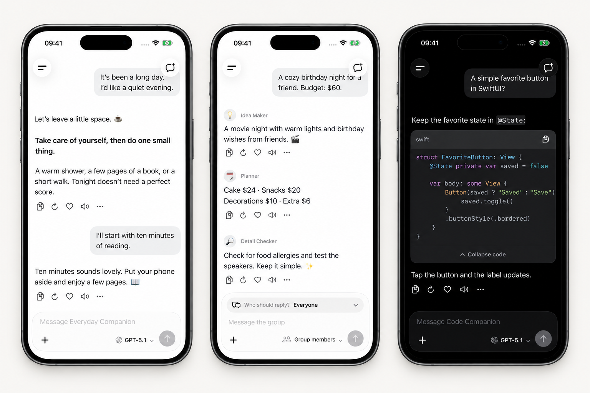

<h1 align="center">Mocca</h1>

A native AI chat app for iPhone. Bring your own models. Keep your conversations on your device.

English · <a href="README.zh-CN.md">简体中文</a>

  

  <a href="https://github.com/UUZsama450/mocca/releases/tag/v1.0.3">IPA preview</a> · <a href="CHANGELOG.md">What’s new</a>

  

Everyday chat · Multiple assistants · Code Framed previews with fictional demo conversations.

View original screenshots

[Everyday chat](docs/images/1.0.3/chat-en.png) · [Group chat](docs/images/1.0.3/group-en.png) · [Code](docs/images/1.0.3/code-en.png)

## Features

- **Your providers and models:** configure AI services and switch models between conversations.
- **Conversations with context:** streaming replies, assistants, group chats, and assistant history searches by title or message content.
- **More than text:** image and file attachments, image replies with supported models, OCR, and voice services.
- **Optional tools:** web search and tool integrations, depending on the services you configure.
- **Your local library:** on-device chat storage, backup and restore, and compatible imports from older backups.
- **Make it yours:** appearance, fonts, avatars, and a Chinese or English interface.

Mocca does not include API keys or third-party service credits. Model capabilities, availability, and charges depend on your chosen provider.

## Getting started

1. Add a provider in Settings and enter its API address and credentials.
2. Choose a model and start a conversation.
3. Configure search, OCR, voice, or other optional services when you need them.

Chats and attachments are stored locally. Requests send the data needed for the selected feature to the configured services. Read [PRIVACY.md](PRIVACY.md) for the data-handling details.

## Download

The [App Store edition](https://apps.apple.com/us/app/mocca-ai-chat/id6807043522) is available in supported regions. The **1.0.3 (5194)** GitHub IPA preview requires your own signing; see [installation](docs/INSTALLATION.md) and [source verification](docs/SNAPSHOT_1.0.3.md). App Store updates are reviewed separately and released manually after approval.

## Build locally

Built with SwiftUI and UIKit.

- iOS 17 or later
- Xcode 26.3, the currently verified development toolchain
- Swift 6

Open `Mocca.xcodeproj` in Xcode and select the `Mocca` scheme. Xcode resolves the pinned Swift package dependency. Simulator builds use a placeholder app identity without a development team. For a device build, copy `Configuration/Local.xcconfig.example` to `Configuration/Local.xcconfig` and enter your own app identifier and team. The extension and background-task identifiers follow the app identifier automatically.

Sponsorship source and avatar decorations are retained. Builds from source default to sponsorship **off** in both Debug and Release: the entry and search result are hidden, and StoreKit loading, listening, purchase, and restore calls are disabled. Existing decoration data is preserved. Developers can explicitly enable sponsorship and select `Mocca/Sponsor.storekit` for simulated purchases.

See [build configuration](docs/BUILD_CONFIGURATION.md) for commands, signing overrides, and sponsorship testing. Machine-local configuration, certificates, and provisioning profiles are not included in source control.

## Origins and acknowledgements

Mocca comes from the [Kelivo](https://github.com/chevey339/kelivo) project and its product and data ecosystem. It develops that foundation into a native iPhone app under an independent name. Thank you to Kelivo and its contributors for the original work.

Mocca is an unofficial, independent project. Some legacy names remain intentionally to preserve backup and data compatibility. See [NOTICE.md](NOTICE.md) for the source and modification history, and [THIRD_PARTY_NOTICES.md](THIRD_PARTY_NOTICES.md) for third-party resources.

## License and contributing

The source is distributed under [GNU AGPL v3.0](LICENSE), except where separate terms apply to third-party materials, names, and trademarks. Provider names and logos identify compatible services and do not imply endorsement.

- [Contributing](CONTRIBUTING.md)
- [Security policy](SECURITY.md)
- [Repository layout and source snapshot](docs/REPOSITORY_GUIDE.md)

Use synthetic examples in reports. Keep API keys, private conversations, attachments, and device logs out of public issues.
