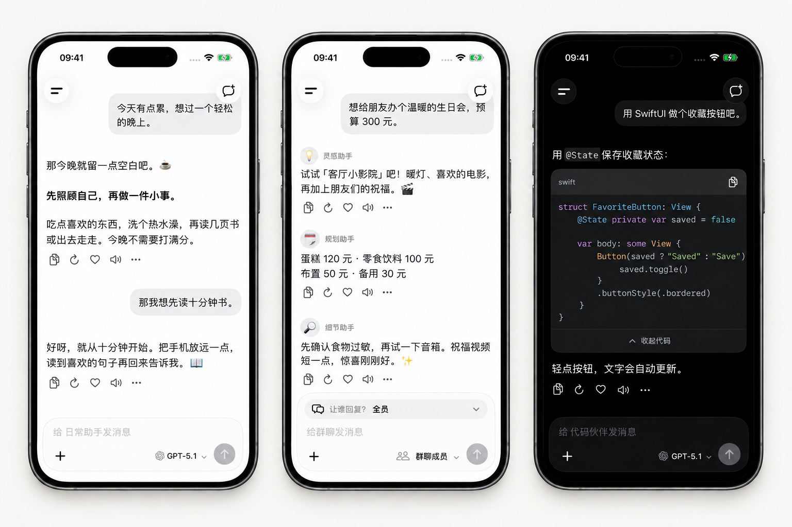

<h1 align="center">Mocca</h1>

原生 iPhone AI 聊天应用。 连接喜欢的模型，把对话留在自己的设备上。

<a href="README.md">English</a> · 简体中文

  

  <a href="https://github.com/UUZsama450/mocca/releases/tag/v1.0.4">IPA 预览包</a> · <a href="CHANGELOG.md">更新说明</a>

  

日常聊天 · 多位助手 · 代码创作 加框展示图，使用虚构的演示对话。

查看原始截图

[日常聊天](docs/images/1.0.3/chat-zh.png) · [多助手群聊](docs/images/1.0.3/group-zh.png) · [代码界面](docs/images/1.0.3/code-zh.png)

## 主要功能

- **选择自己的服务商和模型：** 配置 AI 服务，在对话中切换模型。
- **有上下文的聊天：** 流式回复、助手、群聊，以及助手按标题或消息内容查找历史对话。
- **不只有文字：** 图片和文件附件、支持模型的图片回复、OCR 与语音服务。
- **按需使用工具：** 配置网页搜索与工具服务，扩展聊天能力。
- **本地管理记录：** 聊天存储在设备上，支持备份、恢复及旧版备份的兼容导入。
- **调整使用习惯：** 外观、字体、头像，以及中文和英文界面。

Mocca 不附带 API Key 或第三方服务额度。模型能力、服务可用性和费用取决于你选择的服务商。

## 开始使用

1. 在设置中添加服务商，填写 API 地址与凭据。
2. 选择模型，开始聊天。
3. 有需要时，再配置搜索、OCR、语音等可选服务。

聊天与附件保存在本地。使用相关功能时，请求会将所需数据发送给配置的服务。数据处理说明见 [PRIVACY.md](PRIVACY.md)。

## 下载说明

[App Store 版本](https://apps.apple.com/us/app/mocca-ai-chat/id6807043522)在支持的账号地区提供下载。GitHub 的 **1.0.4（5211）** IPA 预览包需要自行签名，步骤见[安装说明](docs/INSTALLATION.md)和[源码验证](docs/RELEASE_1.0.4_5211.md)。App Store 更新单独送审，通过后手动发布。

## 本地构建

使用 SwiftUI 和 UIKit 构建。

- iOS 17 或更高版本
- Xcode 26.3，目前核验过的开发工具版本
- Swift 6

使用 Xcode 打开 `Mocca.xcodeproj`，选择 `Mocca` scheme，等待解析已锁定的 Swift 包依赖。模拟器构建默认使用占位应用标识，无需开发团队。真机构建时，将 `Configuration/Local.xcconfig.example` 复制为同目录的 `Local.xcconfig`，填入自己的应用标识与开发团队；扩展和后台任务标识会自动跟随。

赞助及头像装扮源码完整保留。自行编译时，Debug 和 Release 均默认**关闭赞助**：隐藏设置及搜索入口，停用 StoreKit 商品加载、交易监听、购买和恢复调用；已有装扮数据保留。开发者可以主动开启赞助，并选择 `Mocca/Sponsor.storekit` 模拟购买。

配置步骤、命令和赞助测试方法见[构建配置](docs/BUILD_CONFIGURATION.md)。本机配置、签名证书和描述文件不纳入源码管理。

## 来源与致谢

Mocca 来自 [Kelivo](https://github.com/chevey339/kelivo) 项目及其产品与数据生态，在此基础上以独立名称发展原生 iPhone 应用。感谢 Kelivo 及其贡献者的原始工作。

Mocca 是非官方的独立项目。部分旧名称有意保留，用于兼容备份与既有数据。来源与修改记录见 [NOTICE.md](NOTICE.md)，第三方资源说明见 [THIRD_PARTY_NOTICES.md](THIRD_PARTY_NOTICES.md)。

## 许可证与参与

除适用独立条款的第三方素材、名称与商标外，源码按 [GNU AGPL v3.0](LICENSE) 发布。服务商名称和图标用于标识兼容服务，不表示合作或背书。

- [参与开发](CONTRIBUTING.md)
- [安全政策](SECURITY.md)
- [仓库目录与源码快照](docs/REPOSITORY_GUIDE.md)

报告问题时请使用虚构示例，不要在公开 Issue 中附上 API Key、私人聊天、附件或设备日志。
